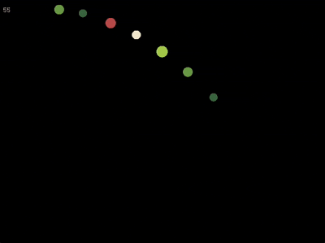

# Particle simulation

A small C++ and SFML project exploring particle motion, collision handling, and parallel processing. Circles move under constant downward acceleration, separate when they overlap, and are grouped into screen cells to reduce collision checks.



I built this while studying mathematics to connect numerical methods with something I could see on screen. It is an experiment: the collision response and time stepping have limitations described below.

## What it does

- Updates particle positions using a position Verlet recurrence.
- Resolves overlaps by moving the two particles apart.
- Groups particles into a uniform grid and checks collisions within each cell.
- Uses two worker threads to process separate cells each frame.
- Adds particles gradually and displays an FPS counter.

The current example creates an 800 × 600 window, adds up to 800 particles, and targets approximately 60 frames per second.

## Build and run

Requirements:

- A C++20 compiler and standard library.
- SFML 2. The original project used SFML 2.6.2.
- `make`.
- A local font file for the FPS counter.

### macOS with Homebrew

```sh
git clone https://github.com/ARandomStrangerr/particle-sim.git
cd particle-sim
brew install sfml@2
```

Before building, update the font path in `main.cpp`. It currently points to a file on my computer:

```cpp
font.loadFromFile("/Library/Fonts/ProggyClean/ProggyCleanCENerdFont-Regular.ttf")
```

Replace that path with one that exists on your machine. For example, if you place a font in `assets/font.ttf`, use:

```cpp
font.loadFromFile("assets/font.ttf")
```

The program returns before opening its window if the font cannot be loaded. Run the executable from the repository directory when using a relative font path.

The makefile also contains paths to my original Homebrew installation. Override them when building:

```sh
make \
  headerFolder="-I$(brew --prefix sfml@2)/include" \
  libFolder="-L$(brew --prefix sfml@2)/lib"
./a.out
```

There is a five-second pause after the window opens, followed by a new particle approximately every 220 milliseconds. The current shutdown waits for the particle-creation thread, so the process can remain running after the window closes until that thread finishes.

For other environments, adjust the compiler and SFML include/library paths in the makefile. The project currently has no automated build checks for other platforms.

## Position Verlet integration

Let $\mathbf{x}(t)$ be a particle's position, $\mathbf{a}(t)=\mathbf{x}''(t)$ its acceleration, and $h$ a fixed time step. For a sufficiently smooth trajectory, expand the position forward and backward around $t$:

$$
\begin{aligned}
\mathbf{x}(t+h) &= \mathbf{x}(t) + h\mathbf{x}'(t) + \frac{h^2}{2}\mathbf{a}(t) + \frac{h^3}{6}\mathbf{x}'''(t) + O(h^4),\\
\mathbf{x}(t-h) &= \mathbf{x}(t) - h\mathbf{x}'(t) + \frac{h^2}{2}\mathbf{a}(t) - \frac{h^3}{6}\mathbf{x}'''(t) + O(h^4).
\end{aligned}
$$

Adding these expressions cancels the velocity and third-derivative terms. Rearranging gives:

$$
\mathbf{x}(t+h)=2\mathbf{x}(t)-\mathbf{x}(t-h)+h^2\mathbf{a}(t)+O(h^4).
$$

Dropping the remainder gives the position Verlet update:

$$
\boxed{\mathbf{x}_{n+1}=2\mathbf{x}_n-\mathbf{x}_{n-1}+h^2\mathbf{a}_n.}
$$

`Object::updatePos` implements this recurrence as:

```cpp
sf::Vector2f v = currPos - prevPos;
prevPos = currPos;
currPos = currPos + v + a * dt * dt;
```

Despite its name, `v` stores displacement between steps. Velocity is implicit in the two positions.

The derivation assumes a fixed step. The current program measures `dt` each frame, so variations in frame time do not follow this fixed-step derivation. The constructor also initializes the previous position by directly subtracting its `initVelcX` and `initVelcY` parameters; these currently act as initial displacements per step.

For a physical initial velocity $\mathbf{v}_0$ and a fixed step $h$, a consistent initialization would instead use:

$$
\mathbf{x}_{-1} \approx \mathbf{x}_0-h\mathbf{v}_0+\frac{h^2}{2}\mathbf{a}_0.
$$

## Collision handling and the grid

The collision routine compares the distance between two stored positions with the sum of their radii. If they overlap, each position is moved by half the overlap in opposite directions. This is a geometric separation rule; it does not calculate collision impulses or enforce conservation of energy.

Checking every particle against every other particle takes $O(n^2)$ comparisons. `ScreenGrid` reduces the comparisons by assigning each particle to a cell and checking pairs within that cell. The benefit depends on how particles are distributed; a densely occupied cell can still require many comparisons.

At the start of each frame, the main thread rebuilds the grid. Two worker threads then claim cells through a shared iterator protected by a mutex. Each particle belongs to one cell for that frame, so the workers process separate groups. The main thread joins both workers before drawing, and a separate mutex prevents the particle-creation thread from changing the particle vector during processing.

The workers are created and joined every frame. They are not a persistent thread pool.

## Known limitations

- **Neighboring cells:** particles in adjacent cells are not checked against each other. Overlap can persist until they enter the same cell, producing sudden corrections.
- **Collision geometry:** the distance calculation uses the shapes' stored top-left positions instead of their centers. This affects particles with different radii. Identical stored positions also cause division by zero when computing the separation direction.
- **Motion after collision:** separation changes the current position without updating the previous position. The next Verlet update interprets that correction as additional motion.
- **Update order:** collision checks and position updates are interleaved within each cell, and each pair is checked in both directions. The result depends on processing order.
- **Time stepping:** the recurrence assumes a fixed step, but the application uses measured frame durations. Numerical stability and energy conservation have not been evaluated.
- **Setup and shutdown:** the source needs a valid local font path, and closing the window does not cancel particle creation.

## Performance observations

In earlier informal experiments on a MacBook Air M2, I observed roughly 300 particles before adding the grid and up to about 2,000 particles at 60 FPS after changing the implementation.

These are historical observations, not a reproducible benchmark or a measured speedup from threading alone. The current example adds at most 800 particles.

## Code layout

| File | Responsibility |
| --- | --- |
| `main.cpp` | Window, rendering loop, particle creation, and frame timing |
| `Object.h` / `Object.cpp` | Particle state, position updates, and collision handling |
| `ScreenGrid.h` / `ScreenGrid.cpp` | Cell assignment and worker-thread coordination |
| `makefile` | Compiler and SFML build settings |
| `illustration/` | Screenshots and animation |

## What I learned

This project helped me connect a numerical recurrence to its implementation, use spatial grouping to reduce collision checks, and coordinate worker threads with `std::thread`, `std::mutex`, and `std::lock_guard`. It also made the interaction between collision corrections and implicit velocity visible.

The next improvements would be a fixed simulation step, collision checks based on particle centers, and checks across neighboring cells. Extending collision checks across cells also requires revisiting synchronization, since workers could then try to modify the same particle.
